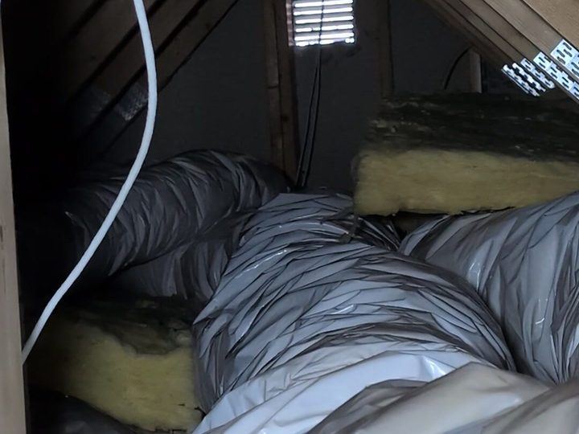
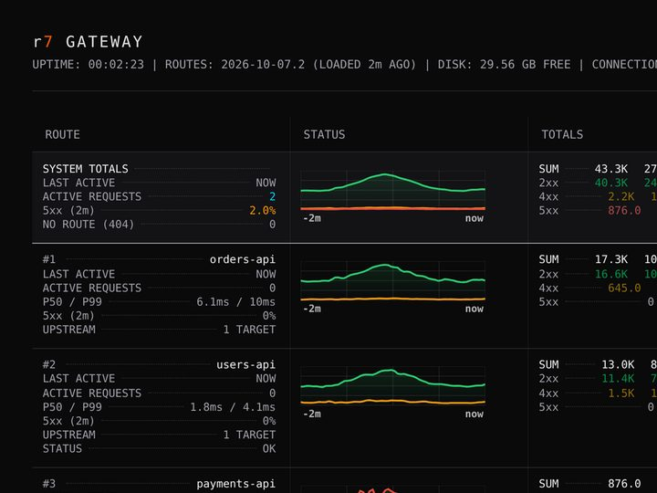
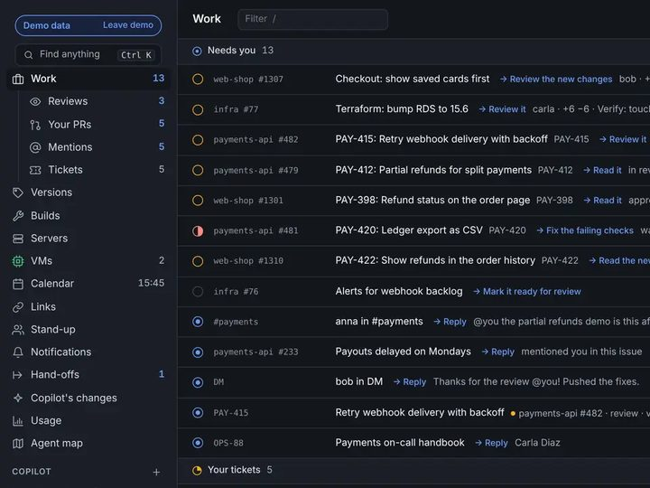

# Notes from the bench

Write-ups of things I have built: software, hardware, and where the two meet. Each one is about something I measured, something that broke, or something I would do differently.

Start here

<a class="kw-card" href="balancing-ventilation-44-watts-for-200-m3h/">

House
44 watts for 200 m³/h: balancing the ventilation myself
</a>
<a class="kw-card" href="a-gateway-that-remembers-every-request/">

Gateway
A gateway that remembers every request
</a>
<a class="kw-card" href="what-an-agent-needs-to-know-i-needed-too/">

AI
What an agent needs to know, I needed too
</a>

Latest

