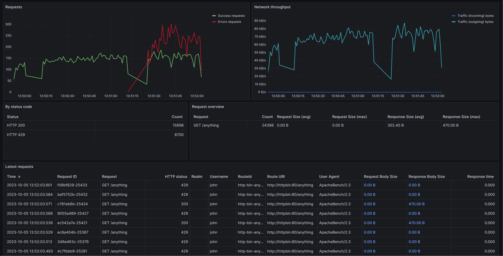

# A gateway that logs every body

"We sent it correctly." I have heard that sentence many times, and most of the time I could not check it.

<!-- more -->

It happens when a new client is onboarded, and even more when it is a client's client. They integrate with us through someone else's system, and often nobody on their side knows what that system sends. We see a rejected request in our logs. We do not see what was in it.

Application logs do not help much here. They log what the application understood, and the problem is usually in the part it did not understand.

So I put a gateway in front that keeps everything. [cloud-gateway](https://github.com/ethlo/cloud-gateway) is a reverse proxy built on Spring Cloud Gateway. It logs the full request and response, headers and body, to ClickHouse, and there is a Grafana dashboard on top.

```bash
docker-compose up -d
curl -uuser:pass http://localhost:6464/get
```

Then Grafana on port 3000 shows the traffic.



*Added later: the dashboard during a test run in October 2023, with ApacheBench against httpbin.*

Now the answer to "we sent it correctly" is the request itself. That ends the discussion quickly, and not always in our favour. Sometimes they did send it correctly.

I know what I am doing here. Bodies hold personal data and secrets, and a full log of them is something I would question in anyone else's design. It needs access control and a short retention time, and it should be on only where it is needed. I think it is worth it for support and remediation. I am less sure I would accept the argument from someone else.
