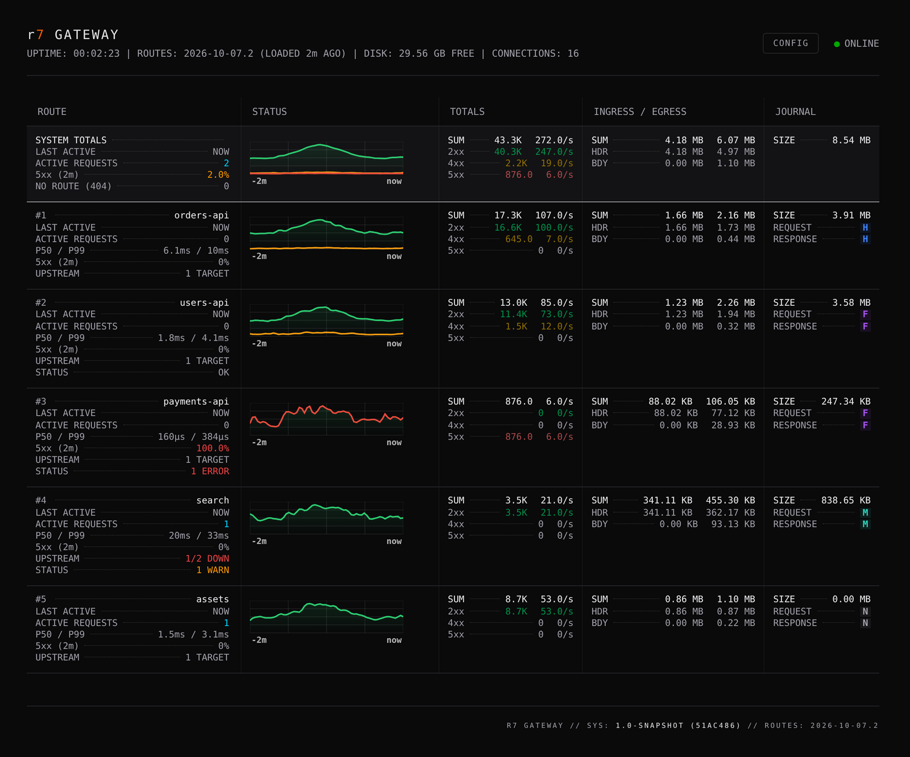

# A gateway that remembers every request

Recording every request body costs my new gateway about a third of its throughput. I think that is cheap.

<!-- more -->

The reason is a question I have been asked too many times: what did the client actually send us?

It comes up when a new client is onboarded. It comes up more when it is a client's client, and nobody on the call knows what their system sends. Somebody says the request was correct, somebody else says it was not, and without a record it is one word against another. With a record it takes a minute.

I have had this since 2023 in [cloud-gateway](https://github.com/ethlo/cloud-gateway), built on Spring Cloud Gateway. It did the job. Two things about it wore me down.

The first is configuration. Spring accepts anything. Write `foo.bar=baz` and it starts without a word, so you have no idea whether a setting stuck or had any effect. A misspelled filter is found by the request that should have gone through it.

The second is the cost of recording on the request path.

## What r7 does differently

[r7](https://github.com/ethlo/r7) has one `routes.yaml`, and it is checked before a single request is served. Unknown keys, misspelled filters, bad regular expressions and missing variables stop it at startup with a message. A bad edit to a running gateway is rejected, and the old routes keep serving.



*The status page, here with demo routes. The last column shows the journal level per route.*

```yaml
routes:
  - id: api
    match:
      - PathPrefix:
          prefix: /api
    upstream:
      targets:
        - url: http://backend:8080
    journal:
      request:
        level: FULL
      response:
        level: FULL
```

The journal is written to memory-mapped files on local disk, so there is no network call while the client waits. A separate process, the tailer, reads the files afterwards and ships them as JSON lines and as WARC, the format web archives use. Secret header and query values are stored as fingerprints and not as the values.

## What it costs

It is not free, and I would not trust anyone who said it was. Measured on two cores, against the same gateway with the journal off:

| Journal level | Throughput lost |
|---|---:|
| `METADATA` | 4 to 14% |
| `HEADERS` | 21 to 25% |
| `FULL` | 34 to 54% |

<svg viewBox="0 0 680 144" role="img" aria-label="Throughput lost per journal level" style="width:100%;max-width:680px;height:auto;font-family:inherit">
<text x="0" y="16" font-size="13" text-anchor="start" fill="currentColor" opacity="0.75">Throughput lost per journal level, percent. Lowest to highest across the scenarios.</text>
<text x="100" y="49" font-size="13" text-anchor="end" fill="currentColor">METADATA</text>
<rect x="110" y="34" width="480.0" height="20" rx="3" fill="currentColor" opacity="0.08"/>
<rect x="142.0" y="34" width="80.0" height="20" rx="3" fill="#4f8cff"/>
<text x="230.0" y="49" font-size="13" text-anchor="start" fill="currentColor">4 to 14%</text>
<text x="100" y="79" font-size="13" text-anchor="end" fill="currentColor">HEADERS</text>
<rect x="110" y="64" width="480.0" height="20" rx="3" fill="currentColor" opacity="0.08"/>
<rect x="278.0" y="64" width="32.0" height="20" rx="3" fill="#4f8cff"/>
<text x="318.0" y="79" font-size="13" text-anchor="start" fill="currentColor">21 to 25%</text>
<text x="100" y="109" font-size="13" text-anchor="end" fill="currentColor">FULL</text>
<rect x="110" y="94" width="480.0" height="20" rx="3" fill="currentColor" opacity="0.08"/>
<rect x="382.0" y="94" width="160.0" height="20" rx="3" fill="#4f8cff"/>
<text x="550.0" y="109" font-size="13" text-anchor="start" fill="currentColor">34 to 54%</text>
<text x="110.0" y="136" font-size="11" text-anchor="middle" fill="currentColor" opacity="0.6">0%</text>
<text x="270.0" y="136" font-size="11" text-anchor="middle" fill="currentColor" opacity="0.6">20%</text>
<text x="430.0" y="136" font-size="11" text-anchor="middle" fill="currentColor" opacity="0.6">40%</text>
<text x="590.0" y="136" font-size="11" text-anchor="middle" fill="currentColor" opacity="0.6">60%</text>
</svg>

The 54% is a browser page with 8 KB of HTML recorded on every request. For API calls, `FULL` costs about a third of the throughput, and adds about 1.5 ms at p99 at 20,000 requests per second.

So recording every body costs a third of the gateway. I think that is cheap for what it answers, on the routes where the question gets asked. On the rest you record headers, or nothing. It is set per route, and it can turn itself up when a response fails.

## Where it stands

On the same two cores r7 sustains 2.3 to 2.9 times what cloud-gateway does. nginx is faster than both by a wide margin, and r7 adds about 2 ms at p99 over it. If you only need a reverse proxy, use nginx.

r7 is pre-release. It does not terminate TLS and has no scripting language, on purpose.
