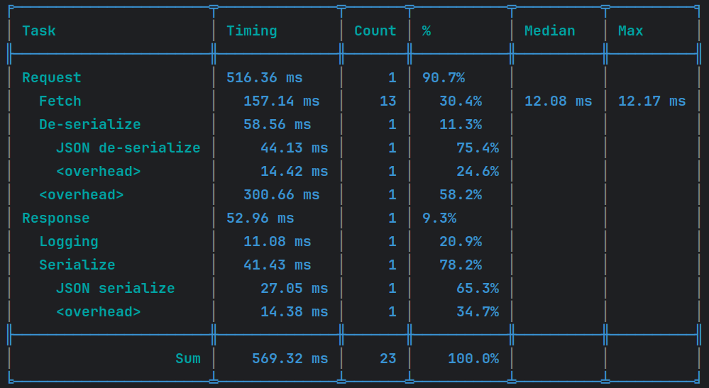

# A stopwatch you can leave on in production

I like profilers. I also cannot use one where I need it most, which is in production, on the request that is slow right now.

<!-- more -->

A profiler tells you things you did not think to ask about, and that is what makes it good. It also slows the application down, and it changes what it measures. You do not attach one to a live system just because an export is slow.

What I can do in production is the dumb thing. Take the time before and after each step, add it up, and print it.

So [Chronograph](https://github.com/ethlo/chronograph) is a stopwatch with names.

```java
final Chronograph chronograph = Chronograph.create();
chronograph.timed("lookup", this::lookup);
chronograph.timed("transform", this::transform);
System.out.println(chronograph.prettyPrint());
```

A task can be timed many times, and you get the average, the total, the count and the share of the whole:

```text
--------------------------------------------------------------------------------
| Task                  | Average      | Total        | Invocations   | %      |
--------------------------------------------------------------------------------
| lookup                |    188.88 μs |     37.048 s |       196,143 |  79.7% |
| transform             |     32.62 μs |      6.398 s |       196,143 |  13.8% |
| sort                  |    306.97 ms |    306.97 ms |             1 |   0.7% |
| xml                   |     16.68 ms |     16.68 ms |             1 |   0.0% |
| serializing           |      1.677 s |      1.677 s |             1 |   3.6% |
| gzip-compressing      |      1.043 s |      1.043 s |             1 |   2.2% |
--------------------------------------------------------------------------------
| Total: 46.489 s                                                              |
--------------------------------------------------------------------------------
```

Look at `lookup`. 189 microseconds is nothing. Nobody would look twice at it. Done 196,143 times it is 37 of the 46 seconds. The slow-looking steps, the sort and the gzip, are noise next to it.

A profiler would have found that too. But this table can go in a log line, behind a switch, and be turned on when someone asks. That is the whole point of it for me.

## What it cannot do

It only measures what I thought to wrap. If the time goes somewhere I did not name, the table adds up to less than the request took and does not say why. A profiler has no such blind spot.



*Added later: output from February 2025. Tasks can be nested now, and the time no named task covers is shown as `<overhead>`. Here that is 300 of the 516 ms in the request.*

And `System.nanoTime()` has nanosecond resolution, not nanosecond precision. For steps that take microseconds or more that does not matter. For real micro-benchmarks, use JMH.
