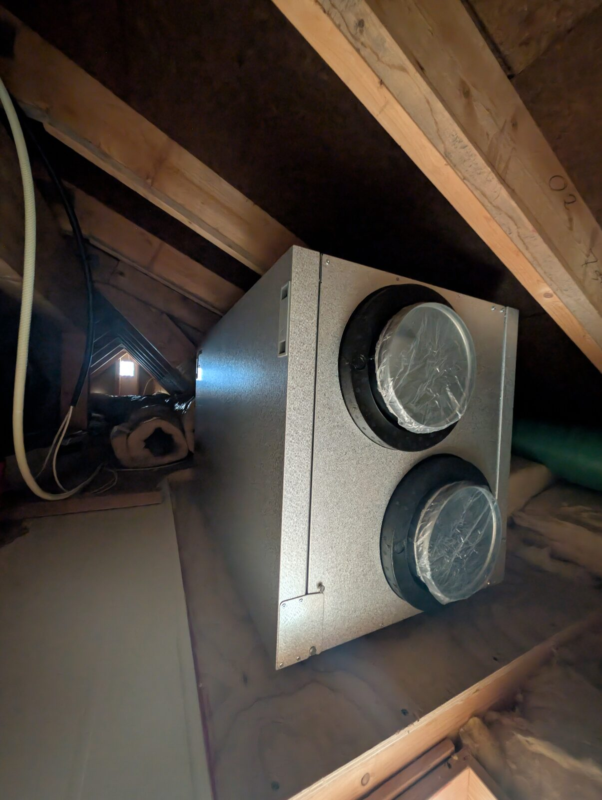
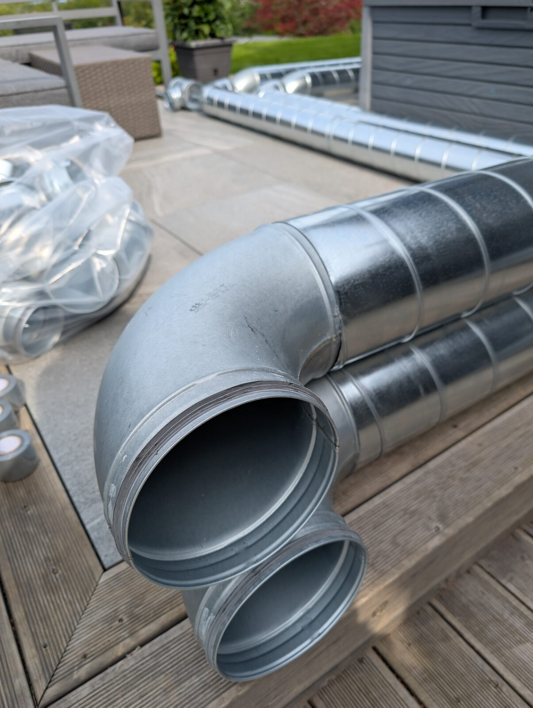
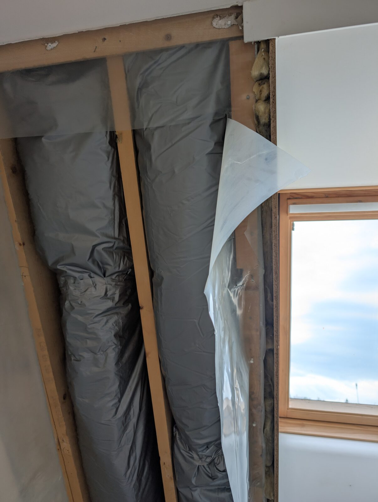

# Balanced ventilation in a house from 2000, with no visible ducts

I spent a month putting balanced ventilation into our house, and I made the job about twice as big as it needed to be. On purpose.

<!-- more -->

The house is from 2000. It is tight enough that air does not leak in by itself, and it had no real ventilation. That is the worst of both. A tight house is what you want for the heating bill, and then you sit in the same air all winter.

We had three reasons to do something. The radon readings were on the border of the limit. There is asthma in the family. And the old system was one Villavent fan shared by the cooker hood, the bathrooms and the laundry room, so smell from one room ended up in the next.

So in June and July 2025 I put in a Flexit L6 SW with a rotating heat exchanger, rated at up to 95%. It stands in the attic. The ducts are spiro in 125, 160 and 200 mm with 50 mm of insulation, about 65 meters of it, run through the attic and down through one chase in a wall.

*The unit in the attic, before the ducts were connected.*

## The over-ambition

The normal design is simple. Fresh air goes into bedrooms and living rooms and is pulled out from bathrooms and the kitchen. Air moves between the rooms under the doors.

I did not want that. I wanted each room to be self-sufficient, so a room with the door shut still gets what it needs. Most rooms therefore have both a supply and an extract valve.

That doubles the ducting. In an existing house it also means ducts that have to cross each other in places that were never built for one duct, let alone two.

*200 and 160 mm spiro duct.*

And I had a second demand that pulled the other way. Nothing was to be visible. No lowered ceilings and no boxes along the walls. So I wanted twice the ducts and none of them in sight, in a house that was finished 25 years ago.

*Two insulated ducts going down through an opened wall. The wall was closed again afterwards.*

Would I do it again? Yes, I would. I will get to why when the valves are set, since that is where the extra ducts are supposed to pay off.

## The joke

I assume the work alone would be 200,000 NOK from a contractor, and likely more with this layout. I paid for parts.

Enova supports balanced ventilation in houses with a building permit from before July 2010. Ours qualifies. But the criteria require that professionals do the installation. So if you pay someone for the standard job, you get support. If you plan, build and measure a more thorough one yourself, you get nothing, however well it performs.

I got no support. That is a joke, tbh.

## What is left

The system runs, but the valves are not set yet. Until they are, I have a lot of duct and no proof that it was worth it.
