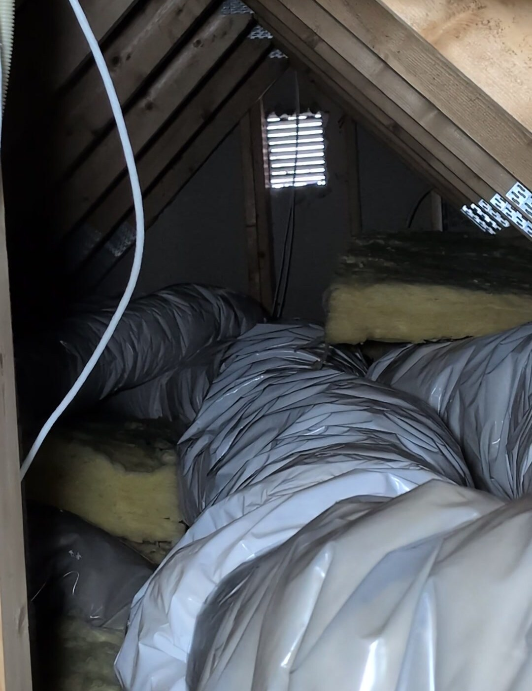
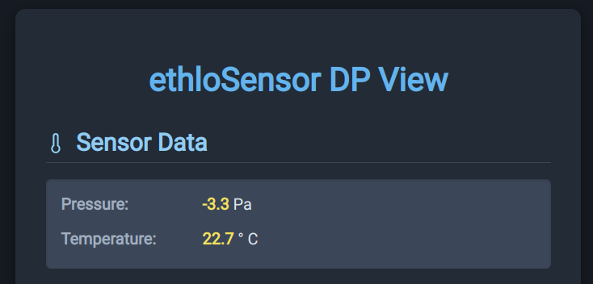
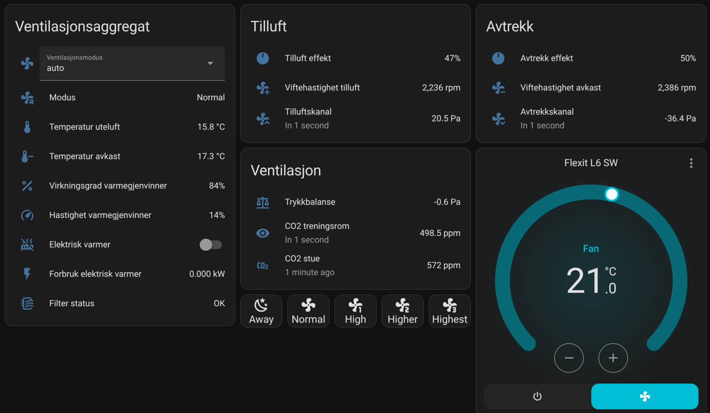

# 44 watts for 200 m³/h: balancing the ventilation myself

The extra ducts paid off. Balancing the ventilation was simple.

<!-- more -->

In June I gave almost every room both a supply and an extract valve, which doubled the ducting. The idea was that each room could be set by itself. In August I got to find out.

I borrowed a flow hood and a flow meter from a friend. It is professional equipment, the kind used for the protocol a contractor hands over. Then I measured every valve in the house.

## One room at a time

With the normal design, air goes in in one room and out in another, so turning one valve changes the rest. Here a room with both valves gets out what it gets in. I could set one room, close the door and go to the next.

| Room | Supply (m³/h) | Extract (m³/h) |
|---|---:|---:|
| Living room 1 | 45.0 | |
| Living room 2 | 45.5 | |
| Loft living room | 42.0 | |
| Gym | 55.0 | 55.0 |
| Bedroom 1 | 52.0 | 52.0 |
| Bedroom 2 | 30.0 | 30.0 |
| Bedroom 3 | 30.0 | 30.0 |
| Laundry room | closed | 50.0 |
| Bathroom 1 | | 43.0 |
| Bathroom 2 | | 40.0 |
| Sum | 299.5 | 300.0 |

That is normal mode: 300 m³/h in and out, for a house of 141 m² and about 300 m³. So the air is replaced once an hour, for 78 watts.

For each valve I wrote down the number of turns from closed. If someone turns one by accident, it can be set back without measuring again.

*Where the ducts meet in the attic, insulated.*

## The modes

<svg viewBox="0 0 680 192" role="img" aria-label="Supply air per mode, m³/h, with the power it takes" style="width:100%;max-width:680px;height:auto;font-family:inherit">
<text x="0" y="16" font-size="13" fill="currentColor" opacity="0.75">Supply air per mode, m³/h, with the power it takes</text>
<text x="180" y="49" font-size="13" text-anchor="end" fill="currentColor">Required minimum</text>
<rect x="190" y="34" width="140.4" height="20" rx="3" fill="currentColor" opacity="0.35"/>
<text x="338.4" y="49" font-size="13" fill="currentColor">170 m³/h</text>
<text x="180" y="79" font-size="13" text-anchor="end" fill="currentColor">Away</text>
<rect x="190" y="64" width="160.7" height="20" rx="3" fill="#4f8cff"/>
<text x="358.7" y="79" font-size="13" fill="currentColor">195 m³/h, 44 W</text>
<text x="180" y="109" font-size="13" text-anchor="end" fill="currentColor">Normal</text>
<rect x="190" y="94" width="247.4" height="20" rx="3" fill="#4f8cff"/>
<text x="445.4" y="109" font-size="13" fill="currentColor">300 m³/h, 78 W</text>
<text x="180" y="139" font-size="13" text-anchor="end" fill="currentColor">High</text>
<rect x="190" y="124" width="296.1" height="20" rx="3" fill="#4f8cff"/>
<text x="494.1" y="139" font-size="13" fill="currentColor">358 m³/h, 111 W</text>
<text x="180" y="169" font-size="13" text-anchor="end" fill="currentColor">Higher</text>
<rect x="190" y="154" width="380.0" height="20" rx="3" fill="#4f8cff"/>
<text x="578.0" y="169" font-size="13" fill="currentColor">460 m³/h, 190 W</text>
</svg>

The lowest mode moves about 200 m³/h for 44 watts. The requirement for this house is about 170. So the setting for when nobody is home is above the minimum, for less than an old light bulb.

The highest mode is the opposite. 190 watts is 2.4 times the power of normal, for 1.5 times the air. It is for cooking and showers, not for running all day.

Extract is slightly higher than supply in every mode, from 0.5 to 14 m³/h. That is on purpose. A small underpressure keeps moist indoor air from being pushed into the walls. The two fans also need different speeds for the same flow, 47% and 50% in normal mode, which I would not have guessed.

## What I did not measure

I measured every valve to half a cubic meter. The heat recovery I did not measure at all. 95% is the manufacturer's upper figure, and it is the number the whole unit is sold on.

So I was careful with the part I had borrowed tools for, and took the rest on trust. Winter will show.

## Watching it afterwards

The house has three pressure sensors of my own now. Two sit on the 200 mm main ducts, in and out. A third, much more sensitive one is mounted in the attic floor and measures the difference between the large open room and the attic. They report to Home Assistant, so I can see live how the system is doing.

*One of the sensors on its own page, in June while I was still building.*

The duct sensors are Sensirion SDP810, a differential pressure sensor that speaks I²C. Four wires. Note that the [datasheet](https://sensirion.com/products/catalog/SDP810-500Pa) draws the pins from below.

<svg viewBox="0 0 680 196" role="img" aria-label="The four pins of the SDP810 seen from below, left to right: SDA, GND, VDD and SCL" style="width:100%;max-width:680px;height:auto;font-family:inherit"><text x="0" y="16" font-size="13" fill="currentColor" opacity="0.75">The four pins of the SDP810, seen from below</text><rect x="100" y="40" width="280" height="90" rx="8" fill="none" stroke="currentColor" stroke-opacity="0.5"/><rect x="80" y="70" width="20" height="30" rx="4" fill="none" stroke="currentColor" stroke-opacity="0.5"/><rect x="380" y="70" width="20" height="30" rx="4" fill="none" stroke="currentColor" stroke-opacity="0.5"/><rect x="141" y="92" width="18" height="18" fill="#4f8cff"/><line x1="150" y1="110" x2="150" y2="150" stroke="currentColor" stroke-opacity="0.6"/><text x="150" y="168" font-size="13" text-anchor="middle" fill="currentColor">SDA</text><text x="150" y="184" font-size="11" text-anchor="middle" fill="currentColor" opacity="0.7">pin 4</text><text x="420" y="70" font-size="13" fill="currentColor"><tspan font-weight="600">SDA</tspan>  I²C data</text><rect x="201" y="92" width="18" height="18" fill="#4f8cff"/><line x1="210" y1="110" x2="210" y2="150" stroke="currentColor" stroke-opacity="0.6"/><text x="210" y="168" font-size="13" text-anchor="middle" fill="currentColor">GND</text><text x="210" y="184" font-size="11" text-anchor="middle" fill="currentColor" opacity="0.7">pin 3</text><text x="420" y="94" font-size="13" fill="currentColor"><tspan font-weight="600">GND</tspan>  ground</text><rect x="261" y="92" width="18" height="18" fill="#4f8cff"/><line x1="270" y1="110" x2="270" y2="150" stroke="currentColor" stroke-opacity="0.6"/><text x="270" y="168" font-size="13" text-anchor="middle" fill="currentColor">VDD</text><text x="270" y="184" font-size="11" text-anchor="middle" fill="currentColor" opacity="0.7">pin 2</text><text x="420" y="118" font-size="13" fill="currentColor"><tspan font-weight="600">VDD</tspan>  supply</text><rect x="321" y="92" width="18" height="18" fill="#4f8cff"/><line x1="330" y1="110" x2="330" y2="150" stroke="currentColor" stroke-opacity="0.6"/><text x="330" y="168" font-size="13" text-anchor="middle" fill="currentColor">SCL</text><text x="330" y="184" font-size="11" text-anchor="middle" fill="currentColor" opacity="0.7">pin 1</text><text x="420" y="142" font-size="13" fill="currentColor"><tspan font-weight="600">SCL</tspan>  I²C clock</text></svg>

*Added later: the dashboard on 27 September 2025, in normal mode. Supply duct 20.5 Pa, extract duct -36.4 Pa, and -0.6 Pa between the house and the attic. The unit reported 84% heat recovery that day, with 15.8 °C outside.*

*Update, November 2026: it has run since without problems.*
