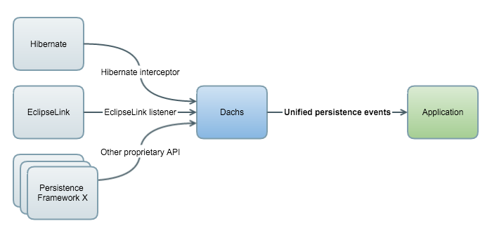

# One change listener for Hibernate and EclipseLink

When core data changes, something else has to happen. A cache entry must go, a search index must be updated, and an audit log wants to know what the value was before. I had one mechanism for all three in my previous job, and missed it in the new one. So I built it again from scratch.

<!-- more -->

Spring has events, and since 4.2 it can send them at the end of a transaction. Spring Data JPA has auditing, but it tells you who changed something and when. It does not tell you what the data was. Calling that auditing is generous.

The persistence frameworks do know. Each of them has its own way of telling you, and none of them agree. Hibernate has interceptors. EclipseLink has descriptor listeners. Write your audit log against one, and you have married it.



[Dachs](https://github.com/ethlo/dachs), the Data Change Snitch, sits in between. It collects everything that is created, updated and deleted inside a transaction, and hands it over as one change set:

```java
public interface EntityChangeSetListener
{
	void preDataChanged(EntityDataChangeSet changeset);
	void postDataChanged(EntityDataChangeSet changeset);
	void begin();
}
```

`preDataChanged` runs just before commit, and an exception there aborts the transaction. `postDataChanged` runs just after. That split matters. The audit log belongs before commit, since a change that cannot be logged should not happen. The cache and the search index belong after, since they must not hear about a change that was rolled back.

## Why not use what is there?

That is the fair question. Hibernate Envers does auditing. Each cache has its own invalidation.

But those are three mechanisms for one fact, that this entity changed from this to that. I would sooner have the fact once and let three listeners use it.

It supports Hibernate and EclipseLink so far.
