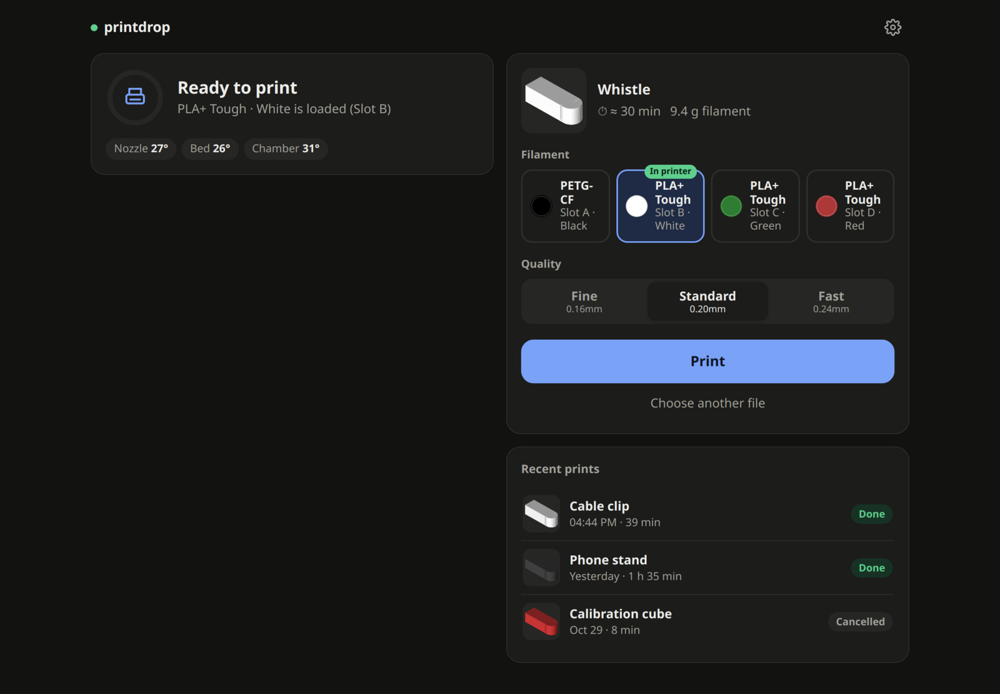
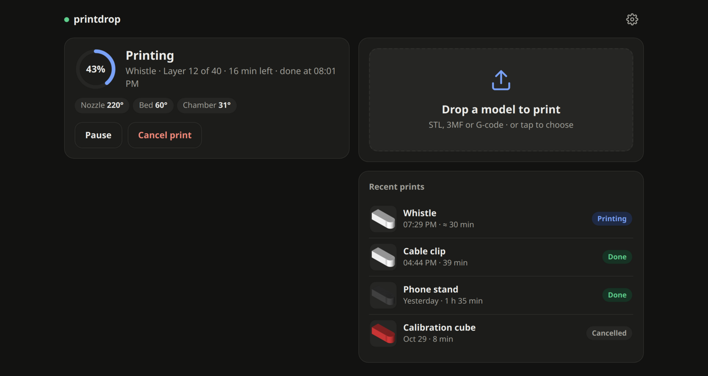

# One drop from model to print

I wanted printing to be as simple as dropping a file on a page. To get there I had to make every decision the slicer normally asks about, once, on behalf of someone who does not want to be asked. That someone is me.

<!-- more -->

A slicer has hundreds of settings. I understand a fair share of them, and I do not want to see them when I print a cable clip. What I want to say is: this model, PETG, go.

So printdrop is a web page with a drop zone. Drop an STL or a 3MF. It slices headless with OrcaSlicer, picks the CFS slot that holds the right material, checks the printer and starts the print. That is the whole user interface for the normal case.



*A dropped model. Filament, quality and Print.*

```bash
curl -F file=@part.stl -F material=PETG -F slot=auto http://printer-host/api/jobs
```

The simple page hides a lot of opinions. Which profile, which layer height, whether the bed is warm enough to skip part of the start routine. I decided that the bed counts as warm if it is within 10 °C of the target, or the last print ended less than 20 minutes ago. Is that right? It is right for me, most of the time, and that is the trade. One decision made well enough is worth more to me than a setting.

## The first print

The first print went fine for 99% of the way and then stopped. It sat there, paused, with the nozzle held at 140 °C.

The cause was almost funny. At the end of a print, the printer cuts the filament and pulls it back into the CFS. The filament sensor saw the filament go away and did what it is there to do. It reported a runout and paused the print, at the last line of it.

So the end macro now turns the sensor off before the cut, and it is on during the print, where a real runout should still pause.

That one mistake says something about the whole idea. Everything I hide from the page I have to get right in the macros, since nobody is looking at a setting that would have shown the problem.

## Where the time goes

A short print on this printer is mostly not printing. It heats, homes, cleans the nozzle, loads filament and purges. So the start macro heats bed, nozzle and chamber at the same time and homes once. The end macro leaves the filament in the toolhead by default, and the next print with the same slot skips a load of about 70 seconds.

The macros print a marker at each phase, and the page shows a bar per job with the seconds for each. I did that before optimising anything, so I would know what was worth doing.



*While it prints.*

## What it checks before the nozzle moves

Klipper must be ready, the macros must be present and the printer must be idle. If the macros are gone, which a firmware update can do, it puts them back, but only when the printer is idle.

It is a tool for one printer and one person. Anything else it refuses, which is why it is simple.
