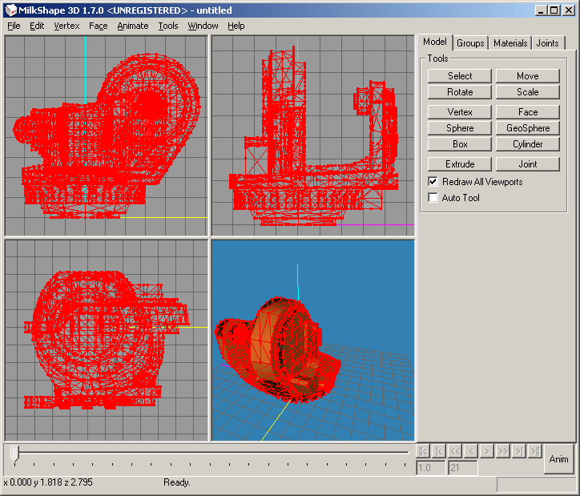

# Robot

After a few days of writing code directly for drawing surfaces and cylinders, it turned out to be very hard work to get a good-looking robot. That gave me the idea of loading a model made in a 3D program instead. This gives much more flexibility when the models need updating, and it also makes it possible to set some material properties and light settings there, so that this does not have to be done by hand. The next step is to draw the robot's part models in the right position, and then animate the robot. The robot can be controlled either manually or through a control file, specified in XML.

<!-- more -->

I chose JOGL as the OpenGL implementation, since it is Java based, a language I feel I know well. That way I can spend my time on OpenGL code, and not have to learn a new programming language at the same time. The project started with a simple framework for the program. The framework consists of a window for OpenGL and a simple setup panel where you can see information about the graphics card and the machine, and also control the number of frames per second (fps) you want to show. The framework was easy to adapt, and from then on I only had to change the drawing routines to present graphics.

After a short while I realised that making a robot that looks like an industrial robot, hard-coded through OpenGL commands, would take a lot of time and be hard to update. Especially when updating individual parts of the robot. It would mean that e.g. swapping between different tools on the robot would be difficult if that kind of functionality was wanted later. So I started looking at how I could draw finished models loaded from file. OpenGL is only an API for drawing 2D and 3D, and has no support for anything like that, so I had to write the code for it myself.

## Converting and loading models

Once it was clear that I wanted to use drawn 3D models, I started looking for models of the robot. The robot at the IR department in Sarpsborg is from 92-93, so there was not much data to find about it on ABB's web pages. I went for a newer and more sophisticated robot instead. CAD models (production drawings) had already been made of this one. The drawings were available in a lot of formats, and many of the tools for working with them are unfortunately both extremely expensive and advanced. After testing about all the shareware versions of CAD software there are, I finally found the program "Rhinoceros", which could load a CAD model from the *.igs format. This program could also export the geometry as a 3D Studio MAX or LightWave file.

More conversion was still needed. 3D Studio MAX and Lightwave have relatively complex file formats, and I did not want to parse those directly. The next task was to find a suitable file format to read into the program, since most of these formats (3D Studio Max and Lightwave) are hard to read, and are often proprietary or without available documentation. A standard ASCII file format would be ideal for reading and parsing in Java, and after searching for a while I found the program MilkShape. It supports importing many well-known file formats and can export to a relatively simple ASCII format, which was also well documented. Milkshape is a simple modelling program originally made for working with models from the game Half-Life. Over time it has got support for many more formats, and a lot of people prefer it today because of the low price and because it is easy to use. Like most other 3D programs, Milkshape lets you set material properties and light properties, and it also supports textures. That way you can finish the model in the 3D program, and then use the geometry, material properties and texture names from the ASCII file to draw the model in OpenGL later. It should be mentioned that the models used are from construction drawings, and are therefore very detailed and relatively heavy to render in OpenGL without a proper graphics card.



*Milkshape after loading a model of one of the parts of the robot.*

After understanding the format, I had to find a decent way to represent the models internally as objects in the program. A scene consists of one or more models, which have one or more meshes, which can have a material, which can consist of surface values for reflection, colour etc. and possibly a texture. It turns out to be a small hierarchy of objects. To be able to build a scene in as clear a way as possible, I made classes that represent these.

*Overview of how a scene is built up in the program.*

I also made a separate Texture class. I chose PNG as the format for textures. The Texture class can be extended to support e.g. BMP and JPG, but I have not taken the time to do that. Since it is quite possible that several models use the same textures, I implemented a texture list so that access to a texture can be shared. This avoids loading a texture several times, which again gives faster startup and saves memory.

Note: The textures are under 'program/build/data/textures'. The models are under 'program/build/data/models'.

## Drawing the robot

When the geometry for the parts of the robot has been read in, the next step is to draw the model on the screen. Since these are fairly complex models, there are a lot of triangles to draw. Drawing everything through code every time, or putting it in a "display list", is supposedly not meant to make any difference to performance on modern graphics cards. Still, I saw a 30-40% performance increase in JOGL by using display lists. This may be because the display lists are buffered and drawn through native code in JOGL, so you avoid Java's memory handling and iteration when drawing.

When the program starts, it loads all the models and makes a list of which textures have to be loaded. When all the models are loaded, the next step is to load all the textures needed and give the references to them to each Mesh object that uses the given texture. The next step is to make the display lists for each model, as mentioned in the paragraph above. The Scene object keeps track of which ID the model has in the display list inside OpenGL, and you can get it out when you want to draw a model in OpenGL.

In code it looks like this:

```java
// Load models
String modelPath = "data/models/";
String[] modelFiles = new String[]
{
    "foot.txt",
    "rotation.txt",
    "lower_arm.txt"
    "elbow.txt",
    "upper_arm.txt",
    "floor.txt",
    "mount.txt"
};
// Init scene
this.scene = new Scene();
for (int i = 0; i < modelFiles.length; i++)
{
    this.scene.addModel(new MilkShapeModel(modelPath + modelFiles[i], modelFiles[i]));
}
```

Now that all the models are loaded (textures too), we can prepare the scene for rendering. This is done by calling "prepareScene" in the Scene class from init in OpenGL:

```java
public void init (GLDrawable drawable)
{
    // Save references
    this.gl = drawable.getGL();
    this.glu = drawable.getGLU();
    this.glDrawable = drawable;
    // Prepare scene
    this.scene.prepareScene(gl, glu);
```

This generates the display lists, and the OpenGL ids of the lists are stored in the Scene object so that we can find the right list for a model when we are going to draw it. The robot is drawn like this:

```java
public void display(GLDrawable drawable)
{
    // Clear scene
    gl.glClear(GL.GL_COLOR_BUFFER_BIT | GL.GL_DEPTH_BUFFER_BIT);
    // Reset view
    gl.glLoadIdentity();
    // Update view if user has rotated or zoomed the scene
      gl.glTranslatef(0.0f, -12.0f, zoom);
      gl.glRotated(xrot, 1.0, 0.0, 0.0);
    gl.glRotated(yrot, 0.0, 1.0, 0.0);
    // Draw models
    // Draw robot mount
    gl.glPushMatrix();
      gl.glTranslatef(-7.2f, 0f, -4.6f);
      gl.glScalef(0.3f, 0.3f, 0.4f);
    drawModel(scene.getDisplayListIndex("mount.txt"), gl);
    // Foot
    gl.glPopMatrix();
    gl.glPushMatrix();
    drawModel(scene.getDisplayListIndex("foot.txt"), gl);
    // Rotation model
    gl.glTranslatef(0.0f, 2.0f, 0.0f);
    gl.glRotatef(robotStatus.getAxisAngle(0), 0.0f, 1.0f, 0.0f);
    drawModel(scene.getDisplayListIndex("rotation.txt"), gl);
    // Lower arm
    gl.glTranslatef(3.3f, 5.8f, 1.35f);
    gl.glRotatef(robotStatus.getAxisAngle(1), 0.0f, 0.0f, 1.0f);
    drawModel(scene.getDisplayListIndex("lower_arm.txt"), gl);
    ...
```

## Controlling the robot

The robot can be controlled in two ways. Either fully manually through the GUI, or it can be programmed in advance to perform a series of movements. Manual control of the robot should be fairly intuitive, so I will concentrate on automatic running. This is done by the robot reading an XML file with specifications of which movements to perform at which times. All joints can be moved independently of each other at the same time, at different speeds if that is wanted.

The file has a very simple format, and is best explained with an example:

```xml
<robotprogram axisCount="4">
    <move time="2000">
        <axis id="0" abs="0">-40.0</axis>
        <axis id="1" abs="0">-80.0</axis>
        <axis id="2" abs="0">80.0</axis>
        <axis id="3" abs="0">180.0,-180.0</axis>
    </move>
    <move time="2000">
        <axis id="0" abs="0">40.0</axis>
        <axis id="1" abs="0">80.0</axis>
        <axis id="2" abs="0">-80.0</axis>
        <axis id="3" abs="0">-180.0,180.0</axis>
    </move>
</robotprogram>
```

The file starts by specifying how many axes the robot has (axisCount="4"). Then comes the robot's first combined movement: Axis 0 is to rotate -40 degrees, axis 1 is to rotate -80 degrees and so on. All of this is to be done in the time given by the attribute "time" in the "move" element, in this case 2000 milliseconds. The attribute "abs" says whether the positions for the axes are relative or absolute. So far only relative positions are implemented.

When the robot is going to run such a "program", it first loads the whole file into memory and splits the movement into small fragments that are put in a multidimensional array. When the program has been processed, it can easily be run with a single program thread, since all the axis movements are already calculated. Unfortunately there is no editor for making the file automatically through e.g. a macro recorder. I hope to get this implemented in a future version.

## Conclusion and further work

The requirement for the project that was set at the start of the course should be met with this. Still, there is room for improvements and extensions. Seeing a robot do "real" tasks is of course tempting, but I have not given the robot any specific task, since e.g. moving objects would have to be hard-coded together with the movement of the robot. This could only have been solved by implementing physical laws, so that objects like crates, boxes etc. fall to the floor, and so that you can push things away if they are not too heavy and/or have too much friction. That is a big task in itself, and I have not had time for more than barely making a "shell" for how such functionality can be implemented. The project has become relatively solid, and should be a decent solution to build on. There is a fair bit of code (about 3000 lines), but the code is well commented and it should be possible to find your way around it. Many of the classes can be used for other things than robot animations. The classes are divided into "packages" by what they do, much like Java's own class library.

Further, as already mentioned, it would be nice to make a macro recorder that could record/edit all manual movements done with the robot, so that they can be saved and played back later as a normal XML "program". Since the code for loading new models is now this simple, it should be possible to build a reasonably believable environment where one or more robots work.

## References and examples

Software:

- [Rhinoceros](http://www.rhino3d.com/)
- [Milkshape](http://www.swissquake.ch/chumbalum-soft/ms3d/index.html)
- [JOGL](https://jogl.dev.java.net/)
- [XPP](http://www.extreme.indiana.edu/xgws/xsoap/xpp/)
- [Gage Timer](http://java.dnsalias.com/)
- [Kunststoff L&F](http://www.incors.org/)
- [JCreator](http://www.jcreator.com/)

Literature:

- [OpenGL reference manual, "Blue Book"](http://www.parallab.uib.no/SGI_bookshelves/SGI_Developer/books/OpenGL_RM/sgi_html/bk02.html)
- [OpenGL programming guide, "Red Book"](http://fly.cc.fer.hr/%7Eunreal/theredbook/)

Web:

- [Nehe's OpenGL tutorials](http://nehe.gamedev.net)
- [ABB's robot home page](http://www.abb.com/robotics)

*Written June 2004.*
