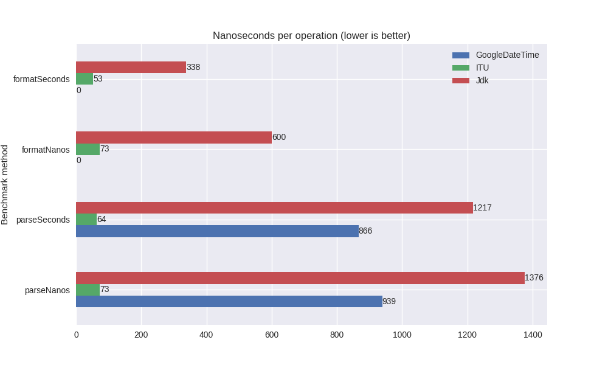

# Seven releases in two weeks

The library worked. I spent two weeks rewriting large parts of it anyway, and broke compatibility on the way.

<!-- more -->

[itu](https://github.com/ethlo/itu) parses and formats RFC 3339 timestamps. I wrote it in 2017, and it had been quiet for a long time. It has served us well, and that is a good state for a library to be in.

What changed is where it runs. It is used on Android phones now. On a server, a slow parser costs a bit of CPU that nobody sees. On a phone the same work is felt by every user. So there was more to gain, and it would have real impact.

<svg viewBox="0 0 680 120" role="img" aria-label="itu releases from 2017 to March 2022: four early ones, a long gap, then seven in thirteen days" style="width:100%;max-width:680px;height:auto;font-family:inherit">
<text x="0" y="16" font-size="13" fill="currentColor" opacity="0.75">Releases of itu, 2017 to March 2022.</text>
<line x1="20" y1="60" x2="660" y2="60" stroke="currentColor" stroke-opacity="0.5"/>
<g font-size="11" fill="currentColor" opacity="0.6" text-anchor="middle">
<text x="20" y="84">2017</text><text x="143" y="84">2018</text><text x="266" y="84">2019</text><text x="389" y="84">2020</text><text x="512" y="84">2021</text><text x="635" y="84">2022</text>
</g>
<g fill="currentColor" opacity="0.6">
<circle cx="39" cy="60" r="5"/><circle cx="151" cy="60" r="5"/><circle cx="153" cy="60" r="5"/><circle cx="342" cy="60" r="5"/>
</g>
<rect x="651" y="44" width="12" height="32" rx="4" fill="#4f8cff"/>
<text x="657" y="36" font-size="12" text-anchor="end" fill="currentColor">1.4.0 to 1.7.0, seven releases in 13 days</text>
<text x="496" y="106" font-size="12" text-anchor="middle" fill="currentColor" opacity="0.75">a long gap</text>
</svg>

Between 26 February and 10 March there were seven releases, 1.4.0 to 1.7.0.

Formatting got a massive improvement in 1.5.0, and nearly doubled again in 1.5.2. The benchmarks were rewritten in JMH, since my old loop with a timer was not something I could defend any longer. Leap seconds are now checked against the list of known ones. And lenient parsing returns a `DateTime` of its own, so `2017-12-06` and `2017-12-06T12:30Z` can both be parsed without pretending the first one has a time.

*The plot from the 1.7.0 README.*

## The part I am less proud of

1.5.0 has a breaking change in a minor version. Parsing null or an empty string used to return null. Now it throws, in line with the `java.time` classes. And 1.6.0 removed the methods for `java.util.Date`.

Both are right. A parser that answers null for nothing hides bugs, and `java.util.Date` should have been gone long ago. But a library that has been quiet for years is one that people have stopped watching. Then it wakes up, and a dependency bump breaks their build.

Should that have been a 2.0? Probably. I wanted the numbers out, and I did not want to wait for a major version to fix what I thought was a mistake from the start.

I would be annoyed at a library that did this to me.
