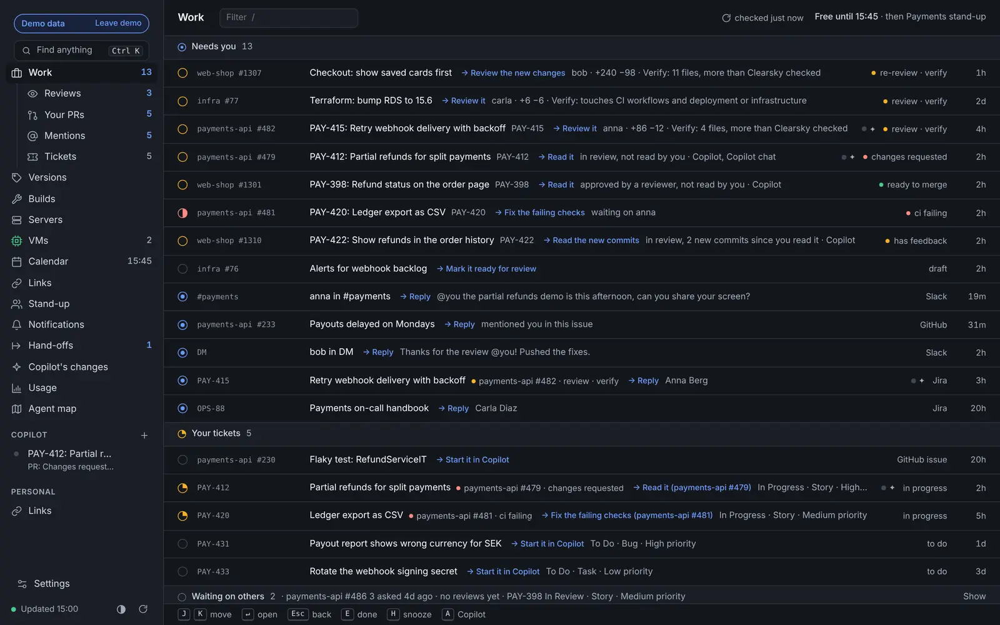
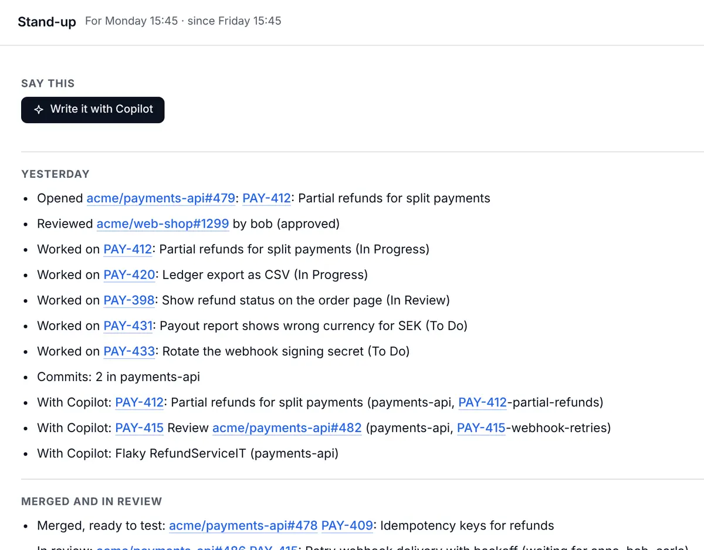
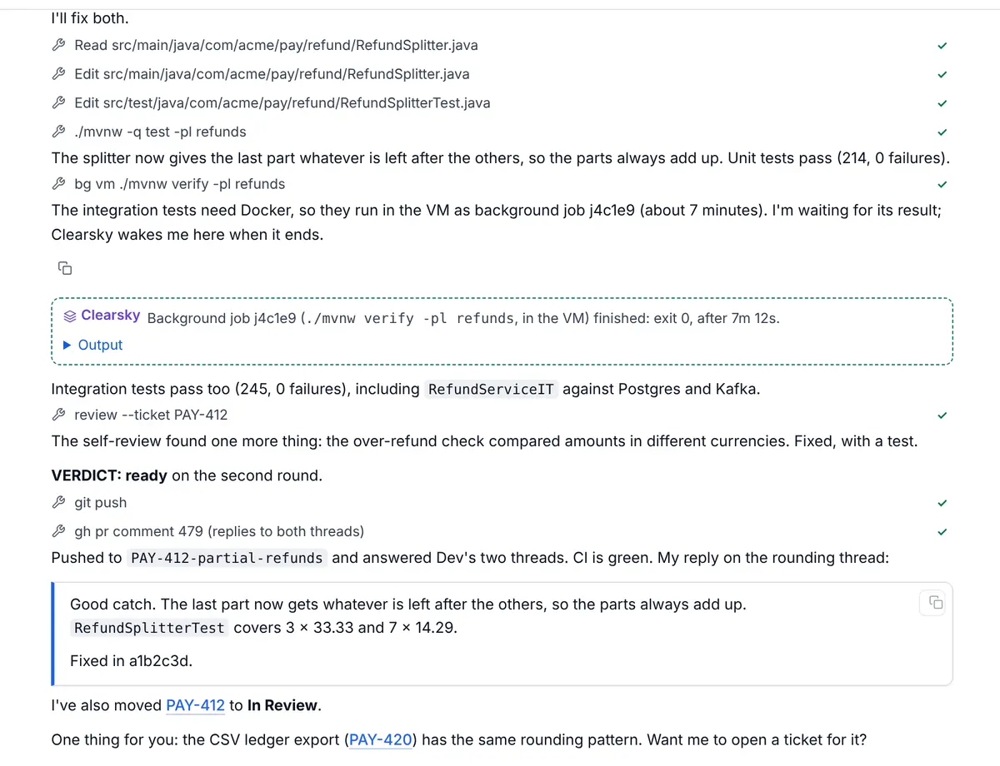

# What an agent needs to know, I needed too

I built a page to give an AI agent the context it needs for my work. The page turned out to be useful with no agent at all.

<!-- more -->

An agent that is going to help with a pull request needs to know things. Which PR, what the ticket says, who is waiting for whom, what the reviewer asked for last. A person on the team has that in their head, or thinks so. An agent has nothing, so you have to collect it and lay it out.

[Clearsky](https://clearsky.ethlo.com) is what came out of that. It is one local page with reviews, my PRs, tickets, mentions, today's meetings and a stand-up summary, and a coding agent in a sandbox next to it. It runs on 127.0.0.1 with the logins the machine already has. There are no tokens to make and no server.



*The work list. The data is made up, as in all the screenshots here.*

## Whose move is it?

To hand work to an agent I had to answer a question I had never answered for myself. What does "needs me" mean?

A review request does. A PR of mine with new comments does. A PR of mine that waits for someone else does not, and it should not sit in the same list. A bot is not a reviewer. A thread where I answered last is not mine any more.

Those are small rules. Written down, they turn five browser tabs into one list, sorted by whose move it is. Each row says the next step: review it, read the new commits, fix the failing checks, reply.

The stand-up is the same idea. An agent that should summarise my day needs to know what I did: PRs opened and reviewed, tickets moved, commits. Once that is collected, the summary is mostly there before any model has seen it.



*Yesterday, from what actually happened.*

I think that is the general point. Preparing information for an AI process means making it explicit, complete and in one place. That is good for the AI. It is also what a new colleague needs, and what I need on a Monday. We just never do it for people, since people cope.

## The agent

The chat runs GitHub Copilot CLI or Claude Code, in my clone of the repo, with the PR or ticket attached.



*A chat on a PR.*

I did not want to judge shell commands one by one. So Clearsky does not try. The agent runs in a sandbox that keeps it to my folders and a list of hosts, and a few doors lead out. Reading goes through. A push, a ticket change or a new host waits until I click Allow. My GitHub login never enters the sandbox.

Clearsky itself only reads. It never replies, merges or marks anything as read.

The chat is useful. The list is what I would keep if I had to choose.

## Try it

It needs Node 22 and git, and nothing else. `clearsky try` shows it with made-up data, so you can look around before you log in to anything.

```sh
git clone https://github.com/ethlo/clearsky
cd clearsky
sh scripts/install.sh   # never uses sudo
clearsky try            # made-up data, no logins
clearsky serve          # http://127.0.0.1:7777
```
